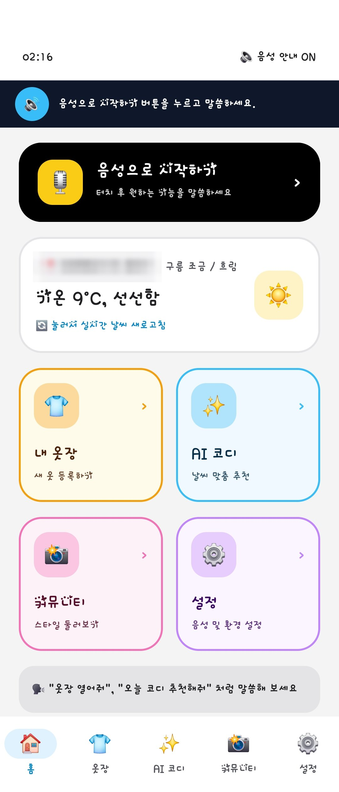
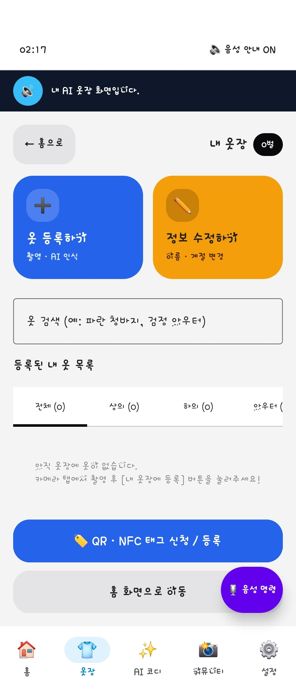
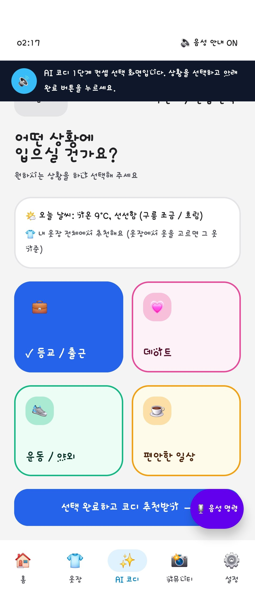
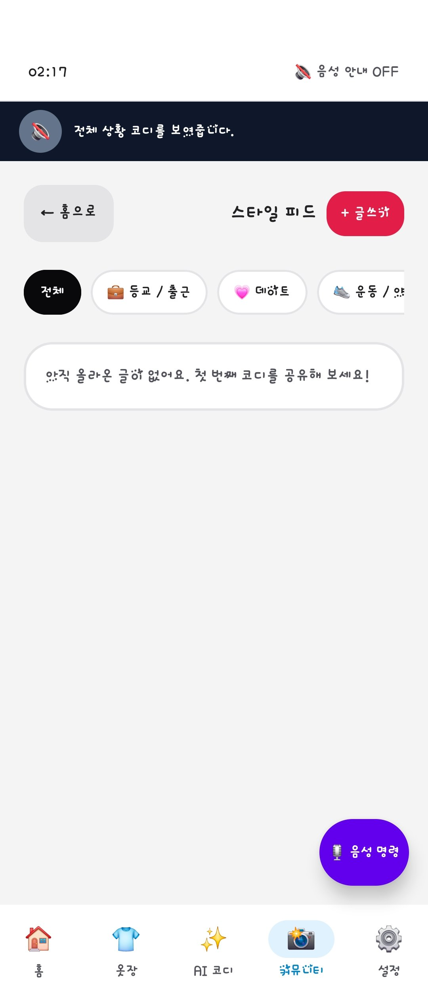
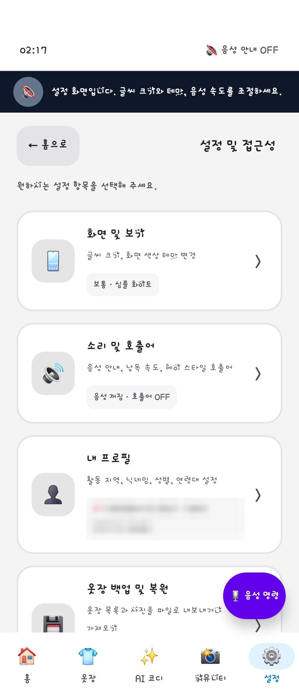

# V-STYLE

음성으로 조작하는 **AI 옷장·코디 추천** 안드로이드 앱입니다. 이 저장소는 **테스트 배포**용이며, 소스 코드는 없고 설치 파일(APK)은 [Releases](../../releases)에서 받을 수 있습니다.

> 개발 중인 테스트 버전입니다. 기능이 불안정하거나 인식이 틀릴 수 있습니다.

  

<table>
  <tr>
    <td align="center"></td>
    <td align="center"></td>
    <td align="center"></td>
    <td align="center"></td>
    <td align="center"></td>
  </tr>
  <tr>
    <td align="center">홈</td>
    <td align="center">내 옷장</td>
    <td align="center">AI 코디</td>
    <td align="center">커뮤니티</td>
    <td align="center">설정</td>
  </tr>
</table>

# 핵심 가치

### 내 옷으로만 (믿을 수 있게)
AI가 그럴듯한 옷을 지어내지 않습니다. 코디는 날씨 적합도, 상황, 색 조합, 무늬 충돌을 따지는 규칙이 **내 옷장 안에서** 고르고, AI는 왜 어울리는지 설명하는 일만 합니다. 옷이 부족하면 있는 척하지 않고, 어울릴 만한 옷을 제안합니다.

### 말로 편하게 (접근하기 쉽게)
"헤이 스타일"이라고 부르고 말하면 화면을 보지 않아도 옷장 열기, 코디 추천, 커뮤니티 글쓰기와 좋아요·투표·댓글까지 할 수 있습니다. 화면 내용을 읽어 주는 음성 안내를 켜고 끌 수 있고, 글씨 크기와 화면 테마도 바꿀 수 있습니다.

### 내 기기 안에서 (안심하고)
옷 인식, 코디 설명, 음성 인식·합성, 호출어가 휴대폰 안에서 처리됩니다. 옷 사진은 기기에 저장되고, 좋아요로 익힌 취향도 기기에만 남습니다.

> AI가 만든 코디와 날씨, 인식 결과는 참고용이며 틀릴 수 있습니다.

# 특징
- 📷 카메라로 찍으면 AI가 상의·하의·아우터·신발·액세서리 같은 **종류와 색**을 알아봅니다. 라벨을 비추면 소재도 읽습니다.
- 🌤️ **오늘 날씨와 상황**(등교·출근, 데이트, 운동·야외, 편안한 일상)에 맞는 코디와 이유, 연출 팁을 알려 줍니다.
- 🗣️ 호출어와 음성 안내로 **화면 없이도** 쓸 수 있습니다.
- 💬 코디를 커뮤니티에 올리고 **투표·좋아요·댓글**로 의견을 주고받습니다.
- 💖 좋아요를 누른 코디의 취향이 **다음 추천에 반영**됩니다.
- 💾 옷장 목록과 사진을 ZIP 파일로 **백업·복원**합니다.

# 주요 기능

### 👕 내 옷장
- **촬영·AI 인식** · 옷의 종류와 색을 알아보고 옷장에 저장합니다.
- **라벨 스캔** · 옷 라벨을 비추면 소재를 읽어 옷 정보에 반영합니다.
- **QR·NFC 태그** · 태그로 옷을 등록하고 불러옵니다.
- **찾기·고르기** · "파란 청바지"처럼 말하거나 입력해서 찾고, 종류별 탭(전체·상의·하의·아우터…)으로 모아 봅니다.
- **정보 수정** · 옷의 이름과 계절을 고칠 수 있습니다.

### ✨ AI 코디
- **상황 선택** · 등교·출근, 데이트, 운동·야외, 편안한 일상 중에서 고릅니다.
- **날씨 반영** · 위치 기반 날씨(기온, 흐림·비 등)를 반영합니다. 위치 권한이 없으면 서울 기준입니다.
- **옷 고르기** · 옷장 전체에서 추천받거나, 옷을 골라 두면 그 옷을 기준으로 코디합니다.
- **이유와 연출 팁** · 왜 어울리는지 설명하고 소리 내어 읽어 줍니다. "다른 코디 보여줘"로 다음 후보를 봅니다.
- **부족한 옷 제안** · 코디를 완성하기에 옷이 모자라면 어울리는 옷을 제안합니다.

### 💬 커뮤니티 (스타일 피드)
- **상황별 보기** · 전체, 등교·출근, 데이트, 운동·야외 등으로 나누어 봅니다.
- **글쓰기** · 내 옷장의 코디와 사진을 붙여 올리고, 두 코디 중 어느 쪽이 나은지 **투표**를 받을 수 있습니다.
- **반응** · 좋아요, 투표, 댓글. 좋아요를 누른 코디의 취향은 기기에만 저장됩니다.
- **이 코디로 추천받기** · 다른 사람의 글에 맞는 코디를 내 옷장에서 바로 추천받습니다.
- **안전장치** · 비속어 사전과 AI로 부적절한 표현을 걸러 내고, 불편한 글은 신고할 수 있습니다.

### 🎙️ 음성·접근성
- **호출어** · "헤이 스타일"로 음성 명령을 시작합니다.
- **음성 안내** · 화면 내용을 읽어 주는 안내를 켜고 끌 수 있고, 읽는 속도를 정할 수 있습니다.
- **자연스러운 AI 음성** · 기본 음성보다 자연스러운 음성 합성을 선택할 수 있습니다.
- **보기 설정** · 글씨 크기와 화면 색상 테마를 바꿉니다.

### 🧰 설정·백업
- **내 프로필** · 활동 지역, 닉네임, 성별, 연령대를 설정합니다.
- **옷장 백업·복원** · 옷장 목록과 사진을 파일로 내보내고 가져옵니다.
 

# 설치 방법
1. 휴대폰에서 [Releases](../../releases) 페이지를 엽니다.
2. 가장 위(최신) 버전의 **`vstyle-…apk`** 파일을 눌러 내려받습니다.
3. 내려받은 파일을 열어 설치합니다.
   - "출처를 알 수 없는 앱" 설치 허용 화면이 나오면, 사용 중인 브라우저(또는 파일 앱)에 대해 **이 출처 허용**을 켭니다.
   - 설치 중 **Play Protect 경고**가 뜨면 "그래도 설치"를 선택합니다. 스토어를 거치지 않은 테스트 앱이라 나오는 안내입니다.
4. 새 버전이 나오면 같은 방법으로 받아 **덮어서 설치**하면 됩니다(옷장 데이터는 유지됩니다).

설치된 버전은 **설정 → 앱 정보**에서 확인할 수 있습니다. 앱을 삭제하면 옷장 데이터도 함께 사라지니, 삭제 전에 **설정 → 옷장 백업 및 복원**으로 백업해 두세요.

# 처음 실행할 때
- 앱이 필요한 **AI 모듈을 처음에 내려받습니다. 반드시 Wi-Fi에서** 실행해 주세요. 받는 동안 기다려야 합니다.

| 내려받는 것 | 크기 |
|---|---|
| 코디 설명 AI(Gemma) | 약 2.4GB |
| 음성 합성(자연스러운 AI 음성) | 약 380MB |
| 음성 인식 | 약 230MB |
| 옷 인식·옷 속성·표현 검사 등 | 약 100MB |
| **모두 받으면** | **약 3.1GB** |

저장 공간은 **여유 5GB 이상**을 권합니다. 음성 합성과 음성 인식 등 일부는 설정이나 Wi-Fi 환경에서 따로 받을 수 있습니다.

- 요청하는 권한은 다음과 같습니다.

| 권한 | 사용하는 곳 |
|---|---|
| 카메라 | 옷 사진 촬영·인식, 커뮤니티 사진 |
| 마이크 | 음성 명령, 호출어("헤이 스타일"), 글 내용 받아쓰기 |
| 대략적인 위치(선택) | 지역 날씨. 거부해도 서울 기준으로 동작합니다 |
| 인터넷 | 모델 내려받기, 날씨, 커뮤니티 |
| NFC(선택) | 옷 태그 읽기·쓰기 |

# 음성으로 써 보기
호출어를 쓰려면 **설정 → 소리 및 호출어**에서 **호출어를 켜** 주세요. 그런 다음 **"헤이 스타일"**이라고 부르고 명령을 말합니다. 홈 화면의 **"음성으로 시작하기"** 버튼을 눌러도 됩니다.

| 하고 싶은 일 | 이렇게 말해 보세요 |
|---|---|
| 화면 이동 | "옷장 열어줘", "커뮤니티", "설정", "홈", "뒤로 가줘" |
| 옷 등록 | "스캔해줘" |
| 옷 찾기·고르기 | "파란 청바지 찾아줘", "검정 아우터 골라줘", "1번 선택해줘", "선택 해제해줘" |
| 코디 추천 | "오늘 코디 추천해줘", "다른 코디 보여줘", "다시 읽어줘" |
| 커뮤니티 글쓰기 | "커뮤니티에 글 올려줘", "내일 데이트 때 입을 옷 추천받고 싶어, 커뮤니티에 글 올려줘" |
| 커뮤니티 반응 | "이 글 좋아요", "1번에 투표해줘", "댓글 달아줘" |
| 안내 소리 | "정지"(읽기 멈춤), "음성 안내 꺼줘", "음성 안내 켜줘" |

- 커뮤니티 반응은 **커뮤니티 화면**에서, 지금 화면에 가장 많이 보이는 글에 적용됩니다.
- 글을 올리거나 댓글을 달 때는 내용을 읽어 주고 **"네"/"아니요"로 확인**한 뒤 등록합니다.
 

# 지원 환경과 알려진 한계
- Android 8.0(API 26) 이상. 온디바이스 AI는 기기 성능에 따라 느리거나 일부 기능이 제한될 수 있습니다.
- 음성 인식이 짧은 말이나 작은 소리에서 틀릴 수 있습니다. 또박또박 말하고, 인식이 틀리면 한 번 더 말씀해 주세요.
- 날씨는 네트워크 상황에 따라 몇 초 걸리거나 직전 값이 "N분 전 정보"로 표시될 수 있습니다.
- 커뮤니티 글에 부적절한 표현이 있으면 등록되지 않습니다.

# 🔒 개인정보 안내 (테스트 전에 꼭 읽어 주세요)
| 정보 | 어디로 가나 |
|---|---|
| 음성 | 기본은 **기기 안에서** 처리됩니다. 커뮤니티 글 내용을 받아쓸 때는 정확도를 높이려고 **구글 음성 인식**을 함께 쓸 수 있어, 이때 음성이 구글 서버로 전송될 수 있습니다 |
| 호출어 학습 녹음 | 참여를 선택한 경우에만 서버로 업로드됩니다 |
| 위치 | 대략적인 좌표가 날씨 서버(기상청, Open-Meteo)로 전송됩니다 |
| 옷 사진 | 기기 안에 저장됩니다. 커뮤니티에 올린 사진과 글은 **서버에 저장되고 다른 사용자에게 보입니다** |

- 수집한 정보의 **보관 기간과 삭제 요청 방법**은 정해지는 대로 이 문서에 안내합니다. 궁금한 점은 [Issues](../../issues)에 남겨 주세요.
- 만 14세 미만 테스터는 보호자의 동의가 필요합니다.
 

# 🤝 문제를 발견하면
[Issues](../../issues)에 아래 내용을 적어 주세요.
- 사용한 기기 모델과 안드로이드 버전
- 앱 버전(설정 → 앱 정보)
- 무엇을 했고 어떻게 되었는지(가능하면 화면 캡처)

화면 캡처에는 닉네임이나 지역 같은 개인정보가 보이지 않게 가려서 올려 주세요.
 

# 📃 라이선스
이 앱은 여러 오픈소스와 AI 모델, 날씨 데이터를 사용합니다. 구성요소별 라이선스와 저작자 표시는 [THIRD_PARTY_NOTICES.md](THIRD_PARTY_NOTICES.md)에 있고, 앱 안의 **설정 → 앱 정보 → 오픈소스 라이선스**에서도 볼 수 있습니다.

이 테스트 배포는 **비상업·연구 목적**입니다. 일부 구성요소는 비상업 용도만 허용하므로, 상업적으로 배포하려면 먼저 사용 조건을 확인하고 필요한 구성요소를 교체해야 합니다.
